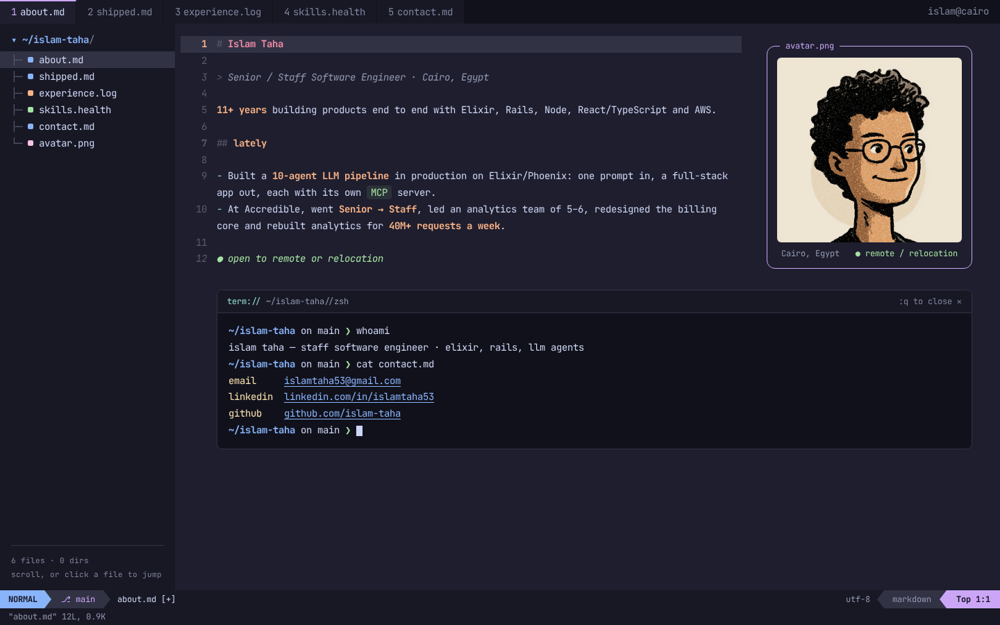

# About-Me

Islam Taha's personal site — a terminal / Neovim-styled "About Me" page.
Static Next.js export (App Router, TypeScript, plain CSS, Catppuccin Mocha,
JetBrains Mono). No database, no env vars, no keys.

```sh
npm install
npm run dev        # http://localhost:3000
npm run build      # static site in out/
npm start          # serve out/ locally
npm run lint && npm run typecheck
```

## Deploying

The site is a fully static export (`output: 'export'`), so it needs no server.

- **Vercel (e.g. Fredrin's Vercel app):** import the repo; framework preset Next.js,
  build command `npm run build`, output directory `out`. No environment variables.
- **GitHub Pages:** run `npm run build` and publish the `out/` folder (for example with a
  Pages workflow that uploads `out/` as the artifact). `public/.nojekyll` is copied into
  `out/` so `_next/` assets are served. A `<user>.github.io` repo serves from the root;
  a project repo needs a `basePath` in `next.config.mjs`.

Replace `public/avatar.png` to swap the portrait.

See [AGENTS.md](AGENTS.md) for conventions. Created with [Fredrin](https://fredrin.com).


